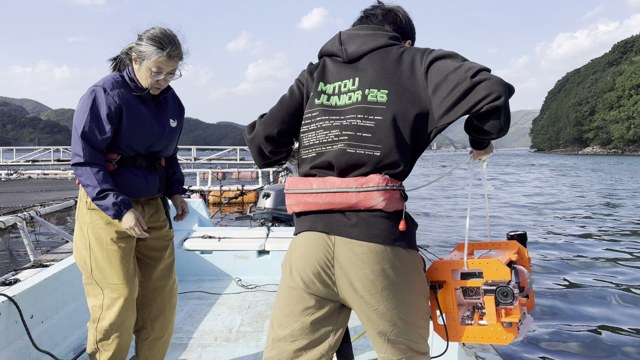
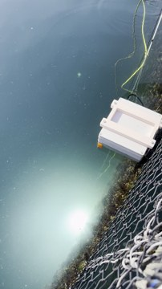

第15回 高校・高専 気象観測機器コンテスト　2次審査実証実験報告書

# AquaBeacon

光と音で水中の撮影位置を記録する観測装置

学校・学年：兵庫県立長田高校 2年　　参加メンバー：神山瑠星

報告日：2026年11月6日

## 1 開発の目的と今回の到達点

水中で撮影した映像を環境調査に使うには、「何が写ったか」に加えて「どこで撮ったか」を記録する必要がある。これまで取り組んだ水中機体では、浮き沈みや撮影、水面からの通信を行えても、映像の撮影位置を把握することが課題として残った。そこで、水上の親機を基準に、水中の子機までの方向と距離を測るAquaBeaconを開発した。

子機のライトを親機カメラで捉えて方向を求め、音が届くまでの時間から距離を求める。親機の傾きをIMUで補正し、GNSS位置と組み合わせることで、子機の観測位置を推定する。子機は水温・圧力と水中映像も記録する。これらを同じ時刻・位置に対応づけ、海の環境を繰り返し観測するための基盤にすることを目指す。

2026年10月28日に学校のプール、10月31日と11月1日に南予の海で実証実験を行った。プールの指定した静止区間では、54観測の親子相対位置のばらつきが3次元RMSで12.75 cmとなった。海では、同じ32観測に親機姿勢を反映すると、RMSは145.45 cmから13.97 cmへ減少した。一方、光源の見失いと地図の断片化が残り、連続した環境地図の作成には改善が必要である。

 

図1　南予での実機投入作業（左）と、水面上の機体・水中の光源（右）。実験で記録した写真を使用した。

本報告のRMSは、各区間の平均位置からのばらつきである。独立に測った正解位置との差ではないため、「位置精度12.75 cm」を達成したという意味ではない。

<!-- pagebreak -->

## 2 製作した機器と独自の工夫

親機と子機に、カメラ、音響系、姿勢センサー、制御基板と防水機構を組み合わせた。親子の制御にはPico 2 Wを用い、センサーデータと時刻を記録する実験用ファームウェアを作成した。機構・回路・ファームウェア・解析を分けて管理し、実験ごとの設定と結果を追跡できるようにした。

表1　親機と子機の役割

| 部分 | 装置・観測 | 役割 |
| --- | --- | --- |
| 水上の親機 | GNSS、カメラ、IMU、音響送信 | 位置基準、子機光源の方向、親機の傾き、音の送信 |
| 水中の子機 | ライト、音響受信、IMU、圧力・温度センサー、カメラ | 光源の提示、測距、姿勢・深度・水温、水中画像の記録 |
| 親子間のテザー | RS485通信 | 測距開始の基準マーカー、時刻・状態情報の伝達 |

### 光と音を別の観測に使う

光は方向、音は距離を測るために使う。子機は、テザーの開始エッジと音響受信エッジを同じ時計で計測する。今回の距離計算は「斜距離＝設定音速1,500 m/s×時刻差」とした。片道の伝搬なので2で割らない。テザー・回路の遅延と温度・塩分による音速変化は、今後の校正対象である。

画像中の光源位置を、レンズの内部校正を使って視線方向に変換する。その視線を親機の計測姿勢で回転し、音響距離を組み合わせて相対位置を得る。親機GNSSを加えれば地理座標への対応が可能となるが、取付位置・方位・GNSSの誤差も含む。撮影時計のずれを補正して、位置と子機画像を対応づけた。今回の結果は記録データの後処理である。

### 従来の取り組みと今回の内容

| 区分 | 内容 |
| --- | --- |
| 従来の取り組み | 水中機体の浮沈、撮影、水面からの通信。撮影位置を記録する課題が残った。 |
| 今回の開発・検証 | 光学方位と音響測距を組み合わせた親子機、姿勢補正、プール・海の位置評価、撮影画像の局所的な三次元再構成。 |

画像の模様だけで位置を追う方法に対し、能動的な光源と音響距離を別に記録する点を設計上の工夫とした。実験では、位置のばらつき、観測が途切れる割合、地図がつながるかを分けて調べた。既存機器より高精度・低価格であるとの比較実証は、現段階では行っていない。

<!-- pagebreak -->

## 3 プールでの実証実験

### 実験方法と評価の定義

10月28日の長田高校プール実験では、子機を静止させた区間と、親子を同時に動かした区間を評価した。静止窓は、映像で入水を確認した時刻から60秒後に始まる60秒間とした。ばらつきが最小になる区間を探索して選んだものではない。既存の位置系列に新たな外れ値除去、補間、平滑化、静止拘束を加えず集計した[1]。

ばらつきは、各有効位置p_iとその平均p̄の差から、RMS＝√{Σ‖p_i−p̄‖²/N}で求めた。一定の位置ずれは平均を引くと消えるため、真の位置に近いことを保証する指標ではない。個々の音響イベントと、同じ測距を再利用する5 Hz時間格子を分けて表2に示す。

表2　入水1分後から60秒間の結果

| 評価系列 | 有効／評価点数 | 位置成立率 | 相対3D RMS | GNSS加算3D RMS |
| --- | --- | --- | --- | --- |
| 音響イベント | 54／54 | 100.0% | 12.75 cm | 18.04 cm |
| 5 Hz時間格子 | 271／300 | 90.3% | 12.88 cm | 18.06 cm |

イベントの100%は、記録された54件に対する割合である。時間全体で位置が得られた割合は90.3%であり、300点を独立した測距300回とは数えない。親子相対位置の水平RMSは12.60 cm、鉛直RMSは1.93 cmで、変動は主に水平方向に現れた。

### 動いているときの欠測と改善

親子同時移動の280秒・1,400格子点では、光学と音響が同時に使える従来位置の成立率は62.4%であった。過去の有効観測を条件付きで利用する位置補完を加えると81.4%、画像確認した光源候補を追加すると82.6%となった[2]。増加の多くは位置補完によるものであり、光源検出だけの改善とは区別する。

プール3区間の追加候補546件のうち491件は画像確認で不採用とした。反射や機体の文字も候補になるため、明るさの条件を緩めるだけでは正しい光源を選べなかった。82.6%は人による画像確認を含む後処理結果であり、完全自動の成立率ではない。

### 不具合の発見と修正

映像の確認で、親機動画の表示回転とカメラ内部校正の向きが一致していないことが分かった。画素・内部校正・姿勢変換を整合させて別の解析結果として保存し、本報告では修正版を使用した。旧結果を上書きせず、どの条件で値が変わったかを追えるようにした。プールの方位には磁気偏角0°と測定中心一致の暫定条件が残る。

<!-- pagebreak -->

## 4 南予の実海域での実証実験

10月31日の2区間、11月1日の5区間を評価した。音響記録は前者がおもに4 Hz、後者がおもに1 Hzである。各60秒の6窓について、同じ採用観測を使い、親機姿勢を区間平均に固定する処理と、計測姿勢で補正する処理を比較した。子機深度は圧力と仮定した海水密度1,025 kg/m³から求めた平均値であり、音響斜距離とは異なる[3]。

表3　同じ観測に対する親機姿勢補正の効果

| 日時・条件 | 平均深度 | 採用／記録 | 姿勢固定RMS | 姿勢補正RMS |
| --- | --- | --- | --- | --- |
| 10月31日14時41分10秒 探索選定 | 6.38 m | 83／170 | 81.94 cm | 16.96 cm |
| 10月31日15時03分 静止 | 4.78 m | 170／170 | 38.06 cm | 14.21 cm |
| 11月1日09時56分 静止 | 14.66 m | 30／54 | 111.47 cm | 14.81 cm |
| 11月1日10時15分 静止 | 16.44 m | 32／43 | 145.45 cm | 13.97 cm |
| 11月1日10時20分 手動揺動 | 16.46 m | 18／55 | 156.07 cm | 33.19 cm |
| 11月1日10時32分 静止 | 6.54 m | 52／54 | 41.99 cm | 38.72 cm |

全窓で姿勢補正後のRMSが小さくなり、親機の傾きを反映する効果を確認した。ただし、10時32分の改善は小さく、条件による差が残った。10時15分は窓の先頭約14秒が測距開始前で、32点は60秒全体を一様に代表しない。手動揺動の18点も、窓全体の動きを等しく表すものではない。

### 海で残った欠測と環境情報

光源候補を画像確認して追加した後も、7区間の位置成立率は12.5～69.9%であった。これは各区間の時間格子に対する割合で、10月31日の分母には投入前・引き上げ後も含む。明るい光源が写っていても、画角端や追跡再開待ちで欠測となる事例があった。欠測をすべて水の濁りや光量不足のためとは判断できない[4]。

11月1日10時15分～10時16分の温度ログ46件の平均は約24.4 °Cであった。圧力深度や画像と同時に環境情報を残せることを確認したが、水温センサーの独立校正は未実施である。水温分布、天候との関係、藻場の変化や炭素吸収量を測定した結果ではない[5]。

### 撮影画像からの地図作成

子機画像の共通する特徴を使って三次元再構成を試みた。南予の追加比較では7区間中3区間で暫定的な実寸断片が得られたが、連続した海底地図には至らなかった。プールの壁区間でも、同じ300画像に位置拘束を与える場合と外す場合の双方で小断片にとどまった。位置が得られても、画像の対応や視差が不足すると地図はつながらないことが分かった[4,5]。

<!-- pagebreak -->

## 5 考察と今後の検証

### 観測機器として分かったこと

光源の方向、音響距離、親機姿勢を組み合わせることで、水中の撮影位置を推定する一連の機器・記録・解析を実環境で試せた。深い静止窓で姿勢補正の差が大きかったことは、同じ角度変動でも距離が長いほど横方向の変位が大きくなる幾何と整合する。ただし、実移動、光源中心の誤認、取付回転や姿勢推定の誤差を個別に分離できていない。

位置の成立率が増えても、ばらつきが必ず減るとは限らなかった。海の手動揺動窓では、光源見直し前後の同時刻220点でRMSが0.321 mから0.437 mへ増加した。追加時刻を含む新系列では2.747 mとなった[4]。今後も、有効点だけのRMSに加え、欠測時間と追加点の妥当性を評価する。

### 次に確かめること

最初に、プール内に独立測量した基準点を設け、平均位置のずれとばらつきを分けて測る。距離、向き、動き、遮蔽を変え、校正に使った条件とは別の条件で評価する。音響回路の遅延、音速、カメラとIMUの取付回転、各センサーの測定中心も順に校正する。

次に、画角外から戻った光源を自動で再捕捉し、反射と区別する方法を改良する。地図作成では、画像の重なりと視差を確保する撮影方法を検証し、基準物の寸法で再構成を確認する。藻場などの同じ場所を繰り返し調べ、画像・水温・深度を位置付きで比較できる観測へ発展させたい。現時点の完成度は、後処理による位置評価と局所再構成までである。

## 6 結論

AquaBeaconを製作し、プールと海で光・音・姿勢を組み合わせた水中位置推定を実証した。静止時のばらつきと姿勢補正の効果を確認し、欠測と画像対応不足という次の課題も得た。今後は、独立真値による検証と自動再捕捉を進め、水中の「観測した内容」と「観測した場所」を一緒に記録できる環境観測装置を目指す。

## 参考資料

[1] 著者実験記録「入水1分後の60秒静止位置評価」、2026年11月5日再集計。54イベントと5 Hz格子を別評価。

[2] 著者実験記録「長田高校プールの光源・位置追加評価」、2026年11月4日。親子同時移動280秒ほか。

[3] 著者実験記録「プール・南予統合研究レビュー」、2026年11月3日整理、南予静止評価6窓・385観測。

[4] 著者実験記録「南予の光源・位置・再構成追加評価」、2026年11月4日。7区間の画像確認後評価。

[5] 著者「AquaBeacon研究レポート」「出典・評価条件」および南予11月1日の同期済み子機温度ログ、2026年11月6日確認。原ログ・設定との対応を保存。回路・ファームウェア等の公開先：[AquaBeaconプロジェクト](https://github.com/AquaBeacon)。
