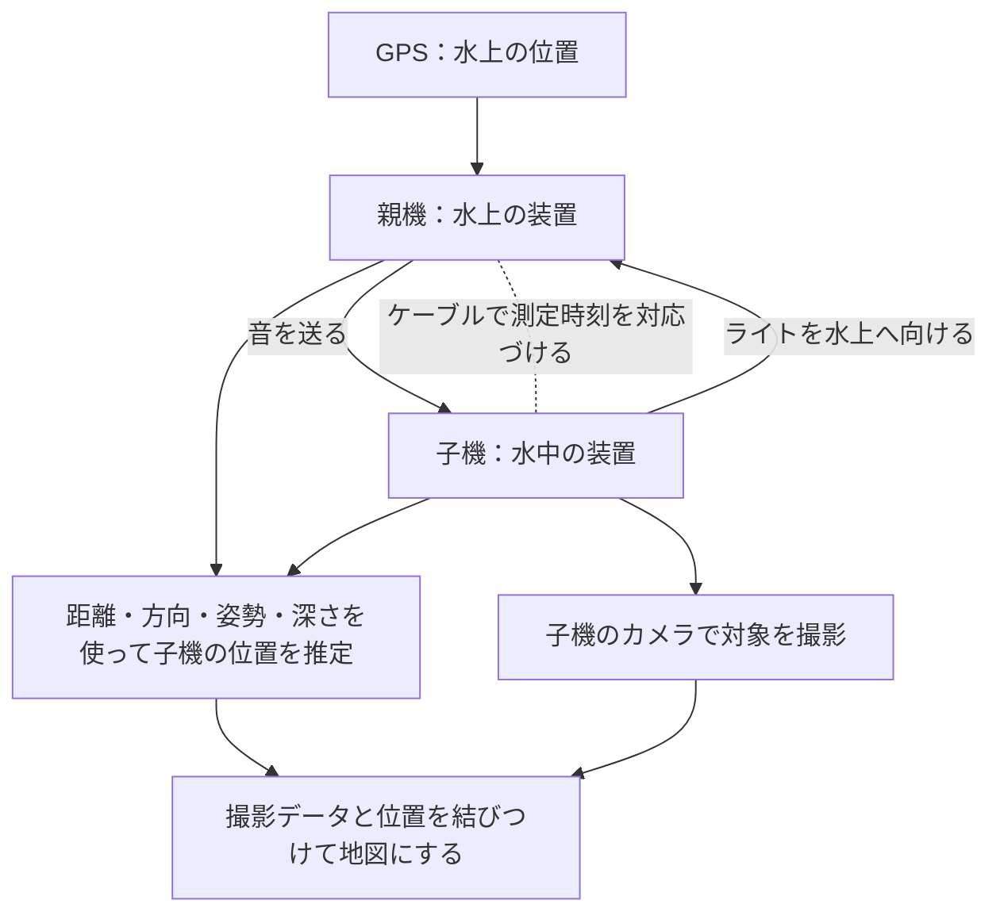

# AquaBeacon 開発概要・開発目標・最終構想

整理日：2026年9月27日  
基準資料：[AquaBeacon.pptx](../AquaBeacon.pptx)（44枚、ファイル更新2026年9月23日）。表紙の「2026.08」は発表用の表記として扱う。以下の「p.」はPPTXのスライド番号を指す。

## 1. 開発概要

**AquaBeaconは、光と音を組み合わせて水中の装置の位置を推定し、撮影した映像を藻場の地図づくりに役立てる研究開発プロジェクトである。**

水上に浮かぶ親機を位置の基準にし、水中にある子機までの距離を音で、方向を光で測る。推定した位置と撮影データを対応づけ、水中の地形や対象物を3Dの地図として記録することを目指す。水中ドローンや水上ドローンへの応用を想定している。[PPTX p.10–13、16]

| 項目 | 内容 |
| --- | --- |
| 主な対象 | 浅い海の藻場など、光を追跡できる水中環境 |
| 解決したい課題 | 水中で「どこを撮ったか」を知り、撮影結果を地図上の位置と結びつけること |
| 技術の中心 | 音響による距離推定と光学による方向推定の組合せ |
| 開発するもの | 親機・子機、音響回路、光学追跡、位置推定処理、マッピング処理、評価用シミュレータ |
| 現段階の処理方針 | センサ値と映像を記録し、後処理で位置推定・マッピングを評価する |
| 将来の利用者 | 藻場調査システムを作る個人・企業、調査や環境保全に取り組む人たち |
| 成果の届け方 | 仕組みや成果をGitHub・論文などで公開し、他の開発者が利用できるようにする構想 |

## 2. 開発の背景と動機

### 藻場を調べるために、位置情報が必要

藻場は海草や海藻が育つ場所である。資料では、ブルーカーボンや環境保全への関心を背景に、藻場の分布面積や被度を調べる必要性を挙げている。被度とは、観察した範囲のうち海草・海藻がどれくらいを覆っているかを示すもの。[PPTX p.5]

潜水や一定の枠内を観察する調査には、人手と時間がかかる。水中ドローンで撮影できても、その映像がどの場所のものか分からなければ、広がりを地図として把握しにくい。AquaBeaconはこの位置情報の取得に取り組む。[PPTX p.5、10–13]

### 藻場では映像だけで位置を推定しにくい

映像から位置や形を推定する手法は、複数の画像で同じ目印を見つけることを利用する。藻場では海藻や魚、光の模様が動くため、安定した目印を得にくい。動くものを除外すると、使える目印が不足することもある。[PPTX p.6–7]

また、水中ではGPSの電波を直接利用しにくい。そこで、GPSを使える水上側と、水中側の関係を測る構成を採る。[PPTX p.9、11–12]

### 開発者の原体験

神山瑠星氏は、スペースバルーンで位置情報を十分に取得できなかった経験をきっかけに、GPSに依存しない位置推定に関心を持った。その後の水中フロート開発でも、水中の位置情報取得の難しさと必要性を実感した。過去の機体としてTriton-3、Triton-4を紹介している。[PPTX p.3–4]

## 3. 仕組み

### 役割分担

| 要素 | 役割 | 一般向けの言い方 |
| --- | --- | --- |
| 水上の親機 | GPSで位置を取得。音を送り、カメラで子機のライトを観測 | 水上に置く、位置の基準となる装置 |
| 水中の子機 | 音を受信。上向きライトを発光し、対象をカメラで撮影 | 水中で撮影する装置 |
| 音響 | 親機から子機へ音が届くまでの時間を測り、距離を推定 | 音で距離を測る |
| 光学 | 子機のライトを親機のカメラで捉え、方向を推定 | 光で方向を測る |
| 姿勢・深度センサ | 装置の傾きや深さを把握し、位置推定を補助 | 揺れや深さも考慮する |
| 有線接続 | 観測時刻の対応づけ・同期などを支える | ケーブルで測定のタイミングを合わせる |
| 子機のステレオカメラ | 2台のカメラで対象を観測し、形状を求める | 水中の形を撮影する |

根拠：PPTX p.11–13、16、39。同期の具体的な実装は補足資料間に変更履歴があるため、ここでは方式を固定しない。

### 位置推定とマッピングの区別

親機のセンサは、カメラを載せた子機がどこにいるかを求める。対象の形は子機のカメラで観測する。位置推定だけで海底形状が得られるわけではない。[PPTX p.16]

水中で推定した位置を、撮影データの配置に直接利用する考え方を、資料では「Underwater Direct Georeferencing」と説明している。一般向け動画では「撮った映像を、位置に合わせて地図にする」と表現する。[PPTX p.13]

## 4. 開発目標

以下の数値は**目標値**である。システム全体の達成済み性能ではない。PPTX p.23の段階目標を優先する。

| 段階 | 開発目標 | 資料上の精度目安 | 確認すること |
| --- | --- | --- | --- |
| ミニマム | プールで位置推定を実証・評価 | 約100mm（10cm） | 既知の位置関係・移動と推定結果を比較する |
| サクセス | プールまたは実海域でマッピングを実証・評価 | 約100mm（10cm） | 既知物体の形・寸法と再構成結果を比較する |
| フルサクセス | 水深10〜20m程度で位置推定とマッピングを実証 | 約300mm（30cm） | 深さや環境条件を記録して評価する |
| 今後の展望 | バイオマス推定、リアルタイム処理など | 今回の資料では合格基準未確定 | 基本機能の実証後に評価方法を具体化する |

**10cm・30cmの評価指標、集計方法、対象範囲は、最終的な実証報告で明示する必要がある。** p.23の表現だけから、すべてをRMSEや最大誤差と決めつけない。面積・体積の評価には別の単位・指標が必要である。

### 相対位置と絶対位置

まず評価するのは、親機から見た子機の相対位置である。地図上の絶対位置は親機GPSの精度にも影響されるため、「水中の位置がGPS込みで10cm精度」とは言わない。[PPTX p.12、25、40]

参考資料p.40には、距離数cm／約15m、角度±0.3°／約10m、相対水平5〜10cm・垂直約5cmという要素別の目標もある。これはp.23の段階目標を補足する値として残し、実績と区別する。

### 検証の進め方

PPTX p.24–25の計画を整理すると、次の順序になる。

1. 水上でGPSを静止させ、位置のばらつきを調べる。
2. 送受信器を既知の距離に設置し、音による距離の測定結果と比べる。
3. 光源とカメラの位置関係を既知量だけ変え、方向の測定を評価する。
4. 親機を既知量だけ動かすなどして、相対位置・変位の誤差を評価する。
5. 大きさが分かっている物体を水中で撮影し、形・寸法・面積・体積を比較する。

追加の整理提案として、各試験で水深、距離、濁り、姿勢、校正方法、サンプル数、欠測数をそろえて記録する。往復して元の場所に戻る試験だけでは経路途中の誤差を十分に評価できないため、既知位置との比較も用いる。

## 5. 資料で確認できる進捗

ここでいう進捗は、基準資料に報告された内容である。9月27日時点の全リポジトリ・実機の状態を監査した結果ではない。

| 項目 | 確認できる内容 | 状態・留意点 |
| --- | --- | --- |
| シミュレータ | センサ誤差、濁り、位置推定、マッピング、他方式との比較を検討 | 作成・検討結果あり。実海域の実証とは区別 [p.14–22] |
| 浅海域での精度 | 透明な環境の10m程度でRMSE100mmを狙える可能性を提示 | シミュレーション上の示唆。資料自体も実機で悪化しうると説明 [p.19] |
| 音響実験 | 送受信基板を作り、学校の25mプールで距離測定を実施 | 部分機能の実験済み [p.29–36] |
| 25m条件の測定 | 水温32.5℃で補正した平均25.039m、受信17/17回 | この実験条件での値。測距精度保証ではない [p.33] |
| 実験の誤差要因 | 手持ち設置による位置・角度ずれ、指向性、反射波を確認 | より厳密な固定・配置での評価が必要 [p.33–36] |
| 機体 | 内装・フレームを作成中と報告 | 資料上は製作進行中 [p.28] |
| 統合した測位・マッピング | 段階目標と評価方法を提示 | 基準資料では達成報告を確認できない [p.23–25] |

音響実験では、25m条件の補正後偏りは+3.9cmだが、20m条件では+17.8cmも報告されている。設置誤差を含むため、都合のよい条件だけを採用して「常に数cm」「全体で10cm達成」と表現しない。[PPTX p.33、36]

## 6. 今後の開発の進め方

PPTX p.26には2026年6〜11月の計画がある。ただし、図と発表者ノートに時期の違いがあり、8月以前の予定も含む。過去の日付を実施済みとみなさず、今後の流れを依存関係で整理する。

| 順序 | 作業 | 次へ進むために確認すること |
| --- | --- | --- |
| 1 | 親機・子機とセンサ記録を整える | 同じ観測に対応する映像・音響・姿勢・深度データを追える |
| 2 | 音・光それぞれを校正・評価する | 設置誤差を抑えた条件で、各測定の誤差を説明できる |
| 3 | プールで位置推定を統合する | 既知位置・変位との比較結果を提示できる |
| 4 | 既知物体のマッピングを行う | 寸法などの評価と、欠測・破綻条件を示せる |
| 5 | より深い場所・実海域・藻場へ進む | 環境条件ごとの成立範囲と制約を記録できる |
| 6 | 成果を整理して公開する | 作り方、処理方法、評価条件を他者が理解・再利用できる |

この表は資料をもとにした作業順序の整理であり、新たな期限や達成を約束するものではない。

## 7. 最終構想

### 今回の開発で目指す到達点

光と音による位置推定からマッピングまでを実証し、藻場の分布調査への応用可能性を示す。その知見や仕組みを公開し、藻場調査システムを開発する人たちが利用できる成果にする。[PPTX p.10、23]

### その先に目指す姿

水中ドローンなどが撮影したデータに位置を付け、藻場の広がりを調べやすくする。さらに、蓄積した形状・分布情報を生物量の推定などにつなげ、環境保全やブルーカーボンに関する取り組みへ貢献する。[PPTX p.5、10、23]

資料から描ける利用の流れは、観測、位置付きの記録、地図化、分布の把握、調査・保全での活用となる。自動的なCO2吸収量の算定、クレジット認証の取得、完全自律航行は今回確認した到達目標には含まれない。

### 前提となる制約

- 光を観測できることが必要。水の濁り、遮蔽、距離、ライトやカメラの向きで性能が変わる。[p.17–19、22]
- 深い海のすべてを対象とするものではなく、浅海域を主な対象にする。[p.14、22–23]
- 親機と有線接続を含む構成を前提とする。[p.12、39]
- 絶対位置の精度にはGPSも影響する。[p.25]
- 今回の主目標は後処理による実証。完成した地図が撮影と同時に出るとは限らない。[p.22–23]
- 既存方式との優劣はシミュレーションの条件に依存する。すべての環境・製品に対する優位を主張しない。[p.20–22]

## 8. 補足設計資料と変更履歴の扱い

既存の設計書には複数時点の仕様が残る。開発目的・目標・進捗は最新指定のPPTXを基準にし、回路や実装の詳細には下記の明示的な変更記録を補足する。元の仕様書は書き換えていない。

| 論点 | 資料上の変更・相違 | この整理での扱い |
| --- | --- | --- |
| 同期方式 | 7月仕様の有線ハードトリガから、GPIO表の7月23日記録ではRS485のソフト同期へ変更 | 「有線で測定時刻を対応づける」と記載。実装の同期精度は未確定 |
| 親機の外形 | 詳細設計書9月4日注記では、円筒フェンダー2本の双胴、マスト廃止、デッキ下面にセンサを直付け | 動画で実機を再現する際は、現物または現行モデルと照合 |
| 親機のカメラ | 詳細設計書9月4日注記にOsmo Action 6への変更 | 古いカメラ前提の光学計算を現行性能とみなさない |
| 回路・UI | GPIO表に送信回路、コネクタ、LCDなどの変更履歴 | 1分動画では部品名や回路定数を説明しない |
| 予算 | 7月の仕様・購入資料には当時の見積がある | 現在価格・残予算・販売価格として用いない |
| 将来の公開 | PPTXではGitHub・論文などでの公開を目標にしている | 公開完了やライセンス確定とは言わない |

## 9. 参照資料

- **主資料**：[AquaBeacon.pptx](../AquaBeacon.pptx)。本文と発表者ノートを確認。課題p.5–9、目的p.10、手法p.11–13・16、シミュレーションp.14–22、目標・評価p.23–25、計画p.26、進捗p.28–36、参考構成・目標p.39–40。
- [AquaBeacon_確定仕様メモ.md](../AquaBeacon_確定仕様メモ.md)：目的、後処理方針、要素目標、7月時点の構成。
- [AquaBeacon_詳細設計書.md](../AquaBeacon_詳細設計書.md)：技術設計と9月4日の機体更新注記。
- [AquaBeacon_実験検証仕様書.md](../AquaBeacon_実験検証仕様書.md)：要素試験・統合試験の評価計画。試験結果報告とは区別。
- [AquaBeacon_基板センサ電源アーキテクチャ決定書.md](../AquaBeacon_基板センサ電源アーキテクチャ決定書.md)：基板分割、センサ、主制御の役割。
- [AquaBeacon_MAIN_UI_GPIO_コネクタ表.md](../AquaBeacon_MAIN_UI_GPIO_コネクタ表.md)：同期・配線・UIなどの明示的な改訂記録。

動画への展開は [02_一般向け60秒動画構成案.md](02_一般向け60秒動画構成案.md) を参照。
